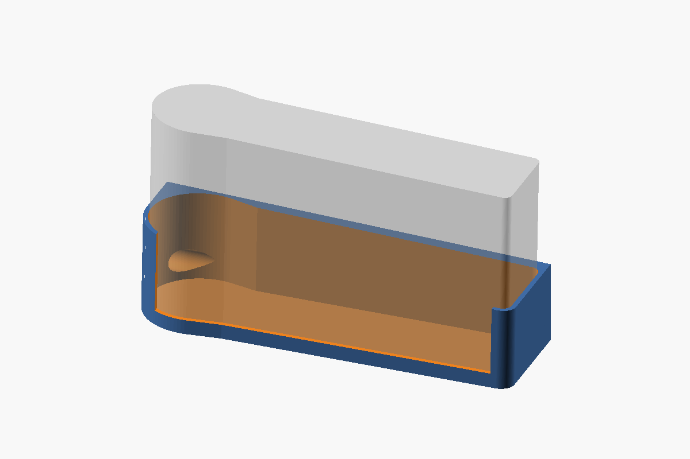
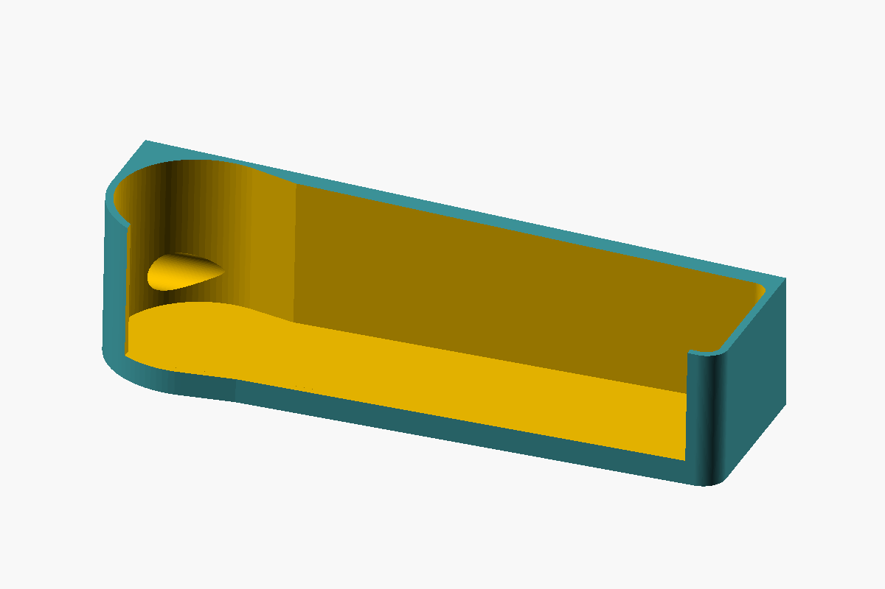
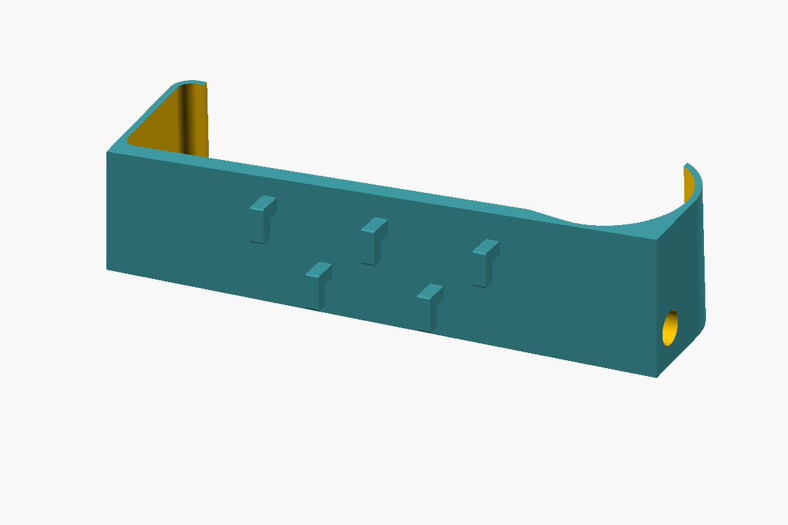
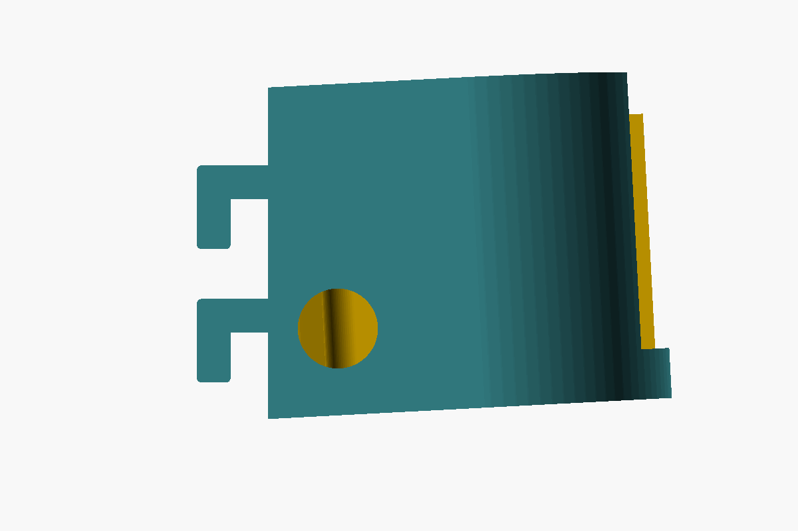

# Sega Nomad SKÅDIS Mount

A single-piece, parametric OpenSCAD mount that displays a Sega Nomad on an IKEA
SKÅDIS pegboard.



| Front | Back (hooks) | Side |
|---|---|---|
|  |  |  |

## Features
- **One piece.** The cradle and five integral SKÅDIS drop-hooks (3 upper, 2 lower, staggered) print as a single part.
- **Fits the Nomad's shape.**
  - A relief pocket in the back plate takes the D-pad grip, so the flat back sits flush.
  - The tray walls follow the top edge's 7mm slope.
- **Leaves the console usable.** It's a lower tray: the screen, buttons and cartridge slot stay uncovered.
  The 5mm front lip sits below the Start/Mode buttons, and there's a cutout for the port on the D-pad end.
- **Leans back 3°**, so the Nomad rests against the plate.
- **Fits a Nomad without a battery pack** attached to the back.

## Build
Requires OpenSCAD 2021.01 or newer.

```sh
make          # -> out/nomad-skadis-mount.stl (stood on its end)
```

Open `nomad-skadis-mount.scad` in OpenSCAD to change settings in the Customizer. Common tweaks:

| Parameter | Default | Purpose |
|---|---|---|
| `clr` | 0.75 | fit gap around the Nomad |
| `recline` | 3 | lean-back angle (degrees) |
| `tray_h` | 40 | wall height at the button end |
| `lip_h` | 5 | front lip height |
| `jack_cutout` | true | hole for the D-pad end port |
| `hook_w`, `stem_len` | 4.8, 5.6 | hook fit in the pegboard slots |
| `show_nomad` | true | translucent Nomad envelope in preview |

## Printing
Tested on a Voron 2.4 300 (OrcaSlicer), PLA. The project file is [`print/nomad-skadis-mount-voron.3mf`](print/nomad-skadis-mount-voron.3mf):
- 0.2mm layers, 3 walls, 100% crosshatch infill, 5mm brim.
- Turn the part so it sits **floor-down, as it hangs**, rotated 3° to cancel the recline so the floor is flat on the bed.
- Enable supports (auto, 30°). They hold up the hook legs and the port hole.

Alternative: print it stood on its button end (how `make` exports it). The hooks
come out strongest and no supports are needed, but it's ~198mm tall and needs a brim.

## Hanging
Tilt the mount, push the hooks through the pegboard slots, then let it drop
so each hook rests on the bottom of its slot.

## Credits
This design remixes the first two models below and is licensed to match the
stricter of them (CC BY-NC). It was re-modelled from measurements, and no
geometry from these models is included in this repository.

- **[IKEA SKÅDIS mount for Analogue Pocket](https://www.printables.com/model/590236)** by
  [Schrockwell](https://www.printables.com/@Schrockwell). Licensed CC BY.
  The tray style and SKÅDIS drop-hook profile follow this design.
- **[SEGA Nomad – Replacement Shell + buttons](https://www.printables.com/model/758393)** by
  [RetroGameRevival](https://www.printables.com/@RetroGameRevival). Licensed CC BY-NC.
  The Nomad's outer dimensions were measured from these shell models.
- **[IKEA Skadis](https://www.printables.com/model/282684)** by
  [Johination](https://www.printables.com/@Johination). Licensed CC0; a remix of
  [IKEA Skadis](https://www.printables.com/model/153436) by [Clay2F](https://www.printables.com/@Clay2F).
  Used as a pegboard reference.

## License
© 2026 James Fryman. Licensed under
[Creative Commons Attribution-NonCommercial 4.0 International (CC BY-NC 4.0)](https://creativecommons.org/licenses/by-nc/4.0/).
See [LICENSE](LICENSE). You may share and adapt it with attribution, for non-commercial purposes only.

SEGA and Nomad are trademarks of SEGA Corporation. IKEA and SKÅDIS are trademarks
of Inter IKEA Systems B.V. This is an unofficial fan project and is not affiliated
with or endorsed by either company.
