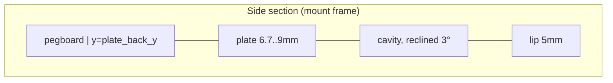

# Mount Geometry

Related: [summary.md](summary.md), [../nomad/dimensions.md](../nomad/dimensions.md), [../skadis/summary.md](../skadis/summary.md).

## Frames
- **Nomad frame**: x = width (D-pad end +x, centred), y = depth (0 = flat back, +y = screen side), z = up (0 = Nomad underside).
- **Mount frame**: `reclined()` = `rotate([recline,0,0])`. A positive recline moves the top toward -y (toward the board).
- The pegboard is the vertical plane `y = plate_back_y()` in the mount frame.

## Tray (Nomad frame)
```openscad
intersection() {
  difference() {
    translate([0,0,-floor_t]) linear_extrude(big) outer2d();  // offset(clr+wall) footprint + squared back half
    cavity();                                                  // offset(clr) footprint, z >= 0
    front_opening();  // x in [x_min+wrap_btn, x_max-wrap_dpad], y > body_d*2/3, z > lip_h
  }
  below_slope(function(x) tray_top(x));  // wall tops parallel to the Nomad top edge
}
```
- `tray_top(x) = tray_h + (x - x_btn) * slope()`: 40mm at the button end, ~47mm at the D-pad end.
- `outer2d()` adds a rectangle over the back half so the end faces are flat
  where they meet the plate. This gives a flat bed face for print orientation.

## Plate (mount frame)
- It is the intersection of a vertical slab (`y >= plate_back_y()`) with the reclined
  region `y_n <= 0, z_n >= -floor_t, below tray_top`. The cavity is then subtracted,
  which carves the **grip pocket** where the grip sticks out past the flat back.
- `plate_back_y() = -(grip_back + clr)*cos(recline) - tray_top(x_max)*sin(recline) - wall`
  keeps at least `wall` of material behind the deepest, highest point of the grip pocket.
- Result: ~6.7mm thick at the floor and ~9mm at the top (with recline = 3°).

## Cutouts
- `jack()`: Ø12 cylinder along +x from the grip axis, at `(jack_y, jack_z)`, through the D-pad end wall.
- The cavity, opening and jack are subtracted **after** the plate union. Otherwise
  the plate fill would close the grip pocket and the jack hole.



## Invariants
- `lip_h` < 7.4 (Start/Mode buttons).
- `tray_h` + wrap must clear the lowest face button (~41mm up, 10.8mm from the button end).
- `x_min`/`x_max` = Nomad ends ± (`clr` + `wall`). The plate spans exactly this so the button end is one plane.
- Changing `recline` changes plate thickness automatically; the hooks stay in a horizontal row.

## Rationale
- The recline is there because a 5mm lip alone lets a 107mm-tall unit tip forward. At 3°
  its centre of gravity sits over the plate side.
- The grip pocket is cut into a solid plate, not through it: the rear face must be flat against the board.
