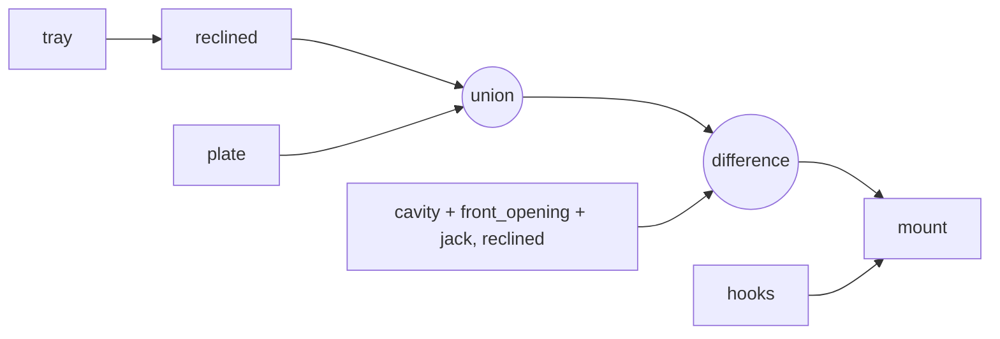

# Mount Domain

`nomad-skadis-mount.scad` produces one solid made of three parts:
1. **Tray** (Nomad frame, then reclined): floor, end walls with front wraps, and a low front lip.
2. **Plate** (mount frame): fills from the reclined tray back to a vertical rear face; holds the grip pocket.
3. **Hooks** (mount frame): five drop-hooks on the plate's rear face.

Design decisions (settled with the user):
- One piece, lower-tray style like the Analogue Pocket mount. The controls,
  screen and cartridge slot stay uncovered.
- Handle both slants: a grip pocket so the flat back sits flush, and wall tops that follow the top slope.
- 5 staggered hooks (3 upper, 2 lower).
- Lean back by 3° so the Nomad rests against the plate instead of the lip.

Details: [geometry.md](geometry.md) · Printing: [printing.md](printing.md) ·
Hooks: [../skadis/summary.md](../skadis/summary.md) · Envelope: [../nomad/dimensions.md](../nomad/dimensions.md)
