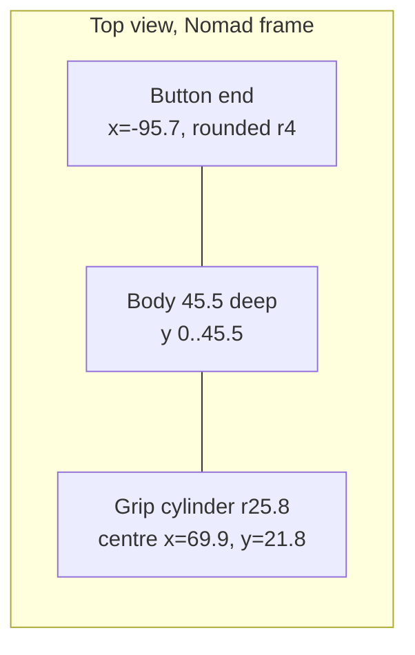

# Nomad Dimensions

Measured from the [replacement shell STLs](https://www.printables.com/model/758393)
(`SEGA-Nomad_Shell_Front.stl` + `_Back.stl`, assembled in place). The shell was
modelled to the original, so these numbers are the device envelope with no
battery pack. Related: [summary.md](summary.md), [../mount/geometry.md](../mount/geometry.md).

## Envelope (mm)
| Feature | Value | Param |
|---|---|---|
| Width end to end | 191.4 | `nomad_w` |
| Height, button end | 100.0 | `nomad_h_btn` |
| Height, D-pad end | 107.0 | `nomad_h_dpad` |
| Flat back to screen face | 45.5 | `body_d` |
| Button-end vertical corner radius | ~4 | `body_r` |
| Grip cylinder radius | 25.8 | `grip_r` |
| Grip axis depth from flat back | 21.8 | `grip_cy` |
| Grip bulge behind flat back | 4.0 | `grip_r - grip_cy` |
| Grip bulge in front of face | ~2.1 | (derived) |
| Body flares into grip from x | 50 | `grip_taper_x` |

- The bottom is flat. The top edge is a straight line rising 7mm toward the D-pad end (~2.1°).
- The grip runs the full height. It has a shallow finger scoop in the middle
  (2mm less bulge), which the envelope ignores.
- The side profile is a slight hourglass (~1mm); the envelope ignores this too.

## Front-face features that constrain the cradle (height above the bottom)
- Start/Mode buttons: 7.4–15.6mm up, x ≈ -8 to -33 (mount frame) → `lip_h` must stay < ~7.
- Lowest ABC/XYZ button: ~41mm up, ~10.8mm in from the button end → limits `tray_h` and `wrap_btn`.
- D-pad bottom: ~50mm up at the grip axis → limits the wall height at the D-pad end.
- Speaker grille: 19–29mm up, 15–33mm in from the D-pad end → limits `wrap_dpad`.

## Ports
- Round port (Ø~7) on the D-pad end: ~10.5mm up, ~1.4mm in front of the flat back
  (probably DC-in; not confirmed). Cut with `jack_cutout`.
- DE-9 controller port on the bottom, rear half, x ≈ -22 (mount frame). No cutout.
- Cartridge slot on top (the tray leaves the top open).



## How it was measured
```python
# per-x slice of the shell vertices (binary STL -> numpy)
s = v[(v[:,0] > x-1) & (v[:,0] < x+1)]
top, bottom, back, front = s[:,2].max(), s[:,2].min(), s[:,1].min(), s[:,1].max()
```
Shell frame → Nomad frame: `x_n = x_s - 4.4`, `y_n = y_s + 23`, `z_n = z_s + 59.9`.
