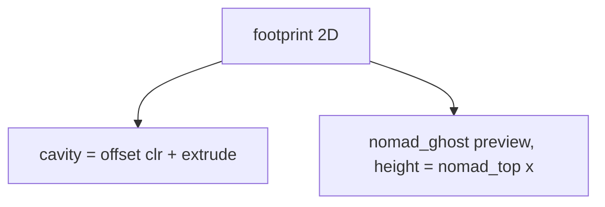

# Nomad Domain

The Sega Nomad is held in landscape with the screen facing out, D-pad on the
viewer's left (+x in model coordinates). It is modelled only as an envelope:
a 2D `footprint()` (a rounded body that flares into a cylindrical grip)
extruded up to a sloped top line. No battery pack is fitted, so the flat back
sits flush on the plate; only the grip sticks out past it.

```openscad
module footprint() {
  hull() { /* button-end rounded corners */ translate(edge) square([0.01, body_d]); }
  hull() { translate(edge) square([0.01, body_d]); translate([grip_cx, grip_cy]) circle(grip_r); }
}
```



- Measured values and front-face constraints: [dimensions.md](dimensions.md)
- How the envelope drives the cradle: [../mount/geometry.md](../mount/geometry.md)

Invariant: the envelope must contain the real device. Prefer erring outward;
`clr` adds the fit gap on top of it.
