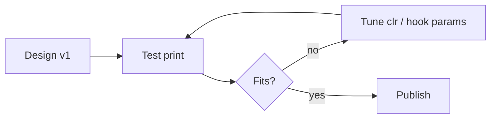

# Roadmap

Current state: first parametric design, printed on a Voron 2.4 300 in PLA (settings in
[../mount/printing.md](../mount/printing.md)). Fit results not yet recorded.

## Open items
- [ ] After validation: upload to Printables (checklist in [../publishing/summary.md](../publishing/summary.md)).
- [ ] Record test-fit results: cradle fit (`clr`), grip pocket, hook fit on a real board.
- [ ] Consider making the slicer pose (floor-down, recline undone) an export option so the STL lands flat without manual rotation.
- [ ] Confirm what the round port on the D-pad end is (DC-in?) and whether the Ø12 cutout lines up.
- [ ] Optional: a notch in the front lip under Start/Mode if the 5mm lip gets in the way.
- [ ] Optional: a floor slot for the bottom DE-9 controller port.
- [ ] Optional: edge chamfers/fillets on the tray tops for looks.

Related: [../mount/printing.md](../mount/printing.md), [../nomad/dimensions.md](../nomad/dimensions.md).
