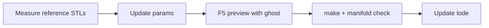

# Practices

## OpenSCAD conventions
- Target OpenSCAD 2021.01+ (the code relies on function literals, e.g. `below_slope(function(x) tray_top(x))`).
- All tunables live at the top of the file in Customizer groups (`/* [Group] */`), with a trailing comment on each.
- Geometry is built in the **Nomad frame**, then `reclined()` maps it into the **mount frame**.
  Only the plate and the hooks are defined directly in the mount frame.
- Derived values are functions (`tray_top(x)`, `plate_back_y()`), not magic numbers.
- Use `big = 400` for cutters and half-spaces; never hard-code large sizes inline.
- Avoid `minkowski()`; use `offset()` on 2D profiles so CGAL renders stay around 2s.

```openscad
module mount() {
  difference() {
    union() { reclined() tray(); plate(); }
    reclined() { cavity(); front_opening(); jack(); }   // cut again after the plate fill
  }
  hooks();
}
```

## Build / verify
```sh
make            # writes out/nomad-skadis-mount.stl in print orientation
openscad --camera=0,10,30,60,0,200,420 --projection=o -D show_nomad=false \
  -o preview.png nomad-skadis-mount.scad   # fixed camera; --viewall zooms out because of the ghost
```
- After any geometry change, check the CGAL output reports `Simple: yes` and `Volumes: 2` (one solid).
- Reference measurements come from slicing STLs with a small numpy script (see [nomad/dimensions.md](nomad/dimensions.md)).

## Workflow


## Lessons
- Printables blocks plain fetches (403). The GraphQL API at `api.printables.com/graphql/`
  (`print(id)` query, `getDownloadLink` mutation) returns metadata and STL links.
