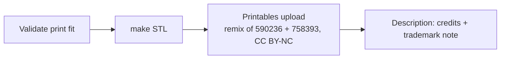

# Publishing & Licensing

The project is licensed **CC BY-NC 4.0** (`LICENSE` = a short preamble plus the official
legal code; © 2026 James Fryman). It is published as a remix of both 590236 (CC BY) and
758393 (CC BY-NC) and inherits the stricter license; the user chose this deliberately.
The source is public at https://github.com/jfryman/nomad-skadis-mount (branch `main`). The STL and SCAD go to Printables once the print is validated. Credits live in `README.md` § Credits and in
the SCAD header comment. Related: [../mount/printing.md](../mount/printing.md), [../plans/roadmap.md](../plans/roadmap.md).

## Upstream references
| Model | Author | License | What we took |
|---|---|---|---|
| [590236 Analogue Pocket SKÅDIS mount](https://www.printables.com/model/590236) | Schrockwell | CC BY | tray style, drop-hook profile (re-modelled from measurements) |
| [758393 Nomad replacement shell](https://www.printables.com/model/758393) | RetroGameRevival | CC BY-NC | envelope dimensions only |
| [282684 IKEA Skadis](https://www.printables.com/model/282684) (remix of [153436](https://www.printables.com/model/153436) by Clay2F) | Johination | CC0 | pegboard reference |

Licenses were read from the Printables GraphQL API (`print(id){license{abbreviation} user{handle}}`).

## Invariants
- The license can't be more permissive than its strictest remix parent (CC BY-NC). Adding a parent
  with a stricter license (e.g. ShareAlike or NoDerivatives) means revisiting `LICENSE`.
- No upstream STL/geometry is committed. Reference STLs stay in the session scratchpad.
- Every upstream model we measure or study gets a README credit (title, author, license, what was used).
- The README keeps the SEGA / IKEA trademark disclaimer.
- The SCAD header carries `SPDX-License-Identifier: CC-BY-NC-4.0` plus a short credit line.

## Printables upload notes
- Mark **590236** and **758393** as remix parents. Choose the license "Creative Commons — Attribution — Noncommercial".
- Credit 282684 (and its parent 153436) in the description as a reference.
- Upload: STL (from `make`), the `.scad`, the Voron 3MF (`print/`), the README renders (`docs/images/`), and photos of the real print.



## README renders
```sh
R="--projection=o --imgsize=1200,800 --colorscheme=Tomorrow"
openscad -q --render --camera=0,10,25,60,0,200,430 $R -o docs/images/front.png nomad-skadis-mount.scad
openscad -q --render --camera=0,0,15,65,0,25,430  $R -o docs/images/back-hooks.png nomad-skadis-mount.scad
openscad -q --render --camera=0,10,20,90,0,90,200 $R -o docs/images/side.png nomad-skadis-mount.scad
openscad -q --camera=0,10,50,60,0,200,560 $R -o docs/images/with-nomad.png nomad-skadis-mount.scad  # preview keeps the ghost
```
Re-render these after any geometry change.
