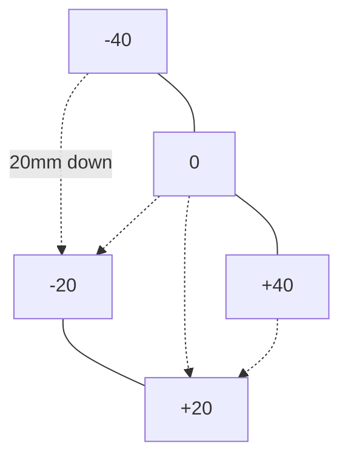

# SKÅDIS Interface

IKEA SKÅDIS pegboard: a 5mm board with 5×15mm vertical slots. Slots sit in
columns 20mm apart; alternate columns are offset 20mm vertically, so slots in
one row are 40mm apart and the next row is 20mm lower and shifted 20mm.
The mount uses integral drop-hooks taken from the
[Analogue Pocket mount](https://www.printables.com/model/590236) (measured from its STL).
Related: [../mount/geometry.md](../mount/geometry.md).

## Hook profile (side view, y toward the board, mount frame)
| Part | Size | Param |
|---|---|---|
| Width (x) | 4.8 (ref 5.05) | `hook_w` |
| Stem height | 5 | `hook_stem` |
| Stem length (board + slack) | 5.6 (ref 6) | `stem_len` |
| Leg thickness | 5 | `leg_t` |
| Stem top to leg bottom | 12.5 | `hook_drop` |
| Edge rounding | 0.6 | (in `hook2d`) |

Invariant: `hook_drop < 15` (slot height) or the hook cannot be inserted.
To hang the mount, tilt it, push the hooks through, then drop it so each stem
rests on the bottom of its slot with the leg behind the board.

```openscad
module hook2d() {
  offset(r = 0.6) offset(delta = -0.6) union() {
    translate([-stem_len, -hook_stem]) square([stem_len + 2, hook_stem]);   // +2 buries it in the plate
    translate([-stem_len - leg_t, -hook_drop]) square([leg_t, hook_drop]);
  }
}
```

## Layout on the plate
- Upper row `hooks_upper = [-40, 0, 40]`; lower row `hooks_lower = [-20, 20]`, `row_pitch` (20) below.
- Upper stem top = `tray_top(hooks_upper[0]) * cos(recline) - hook_top_margin`.
- 5 hooks rather than the reference's 3, because the Nomad is wider and heavier.


