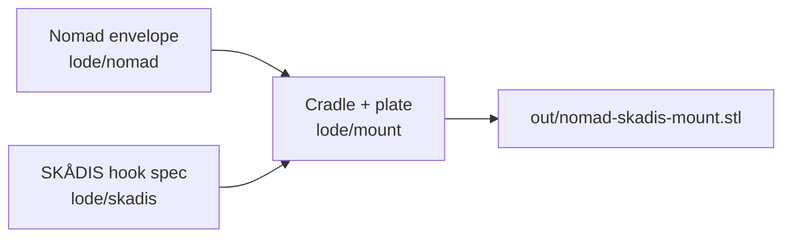

# Project Summary

A single-piece, 3D-printable OpenSCAD mount that holds a Sega Nomad (no battery
pack) in landscape on an IKEA SKÅDIS pegboard. It is modelled on the
[Analogue Pocket SKÅDIS mount](https://www.printables.com/model/590236): a
lower tray with a back plate, a floor, end walls that wrap onto the front, and a
low front lip. Five integral drop-hooks in a staggered 3+2 pattern hang it on
the board. The cradle handles both Nomad asymmetries: the D-pad grip that sticks
out behind the flat back (a relief pocket in the plate) and the sloped top edge
(the wall tops follow it). The tray reclines 3° so the unit rests against the
plate. Everything is parametric in `nomad-skadis-mount.scad`; `make` writes
`out/nomad-skadis-mount.stl` in print orientation. The repo is licensed CC BY-NC 4.0 (inherited
from its remix parents), with upstream credits in the README, and is headed for Printables after a validated print
(see [publishing/summary.md](publishing/summary.md)).

See [lode-map.md](lode-map.md) for the full index.
